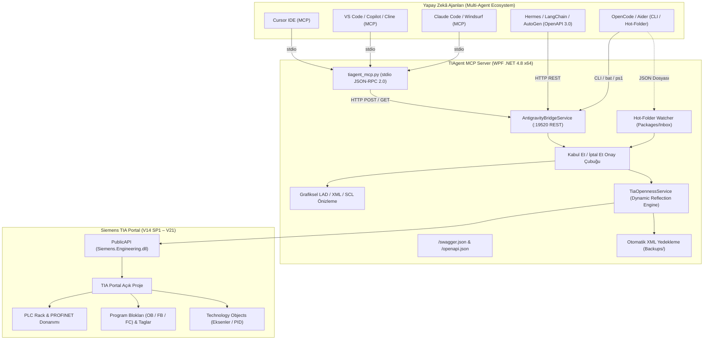

# TIAgent MCP Server — Universal AI Multi-Agent & Siemens TIA Portal Openness Bridge

[](LICENSE)
[-brightgreen.svg)]()
[]()
[]()
[-blueviolet.svg)]()
[]()

> **Quick Language / Hızlı Dil Seçimi:**  
> 🇹🇷 **[Türkçe Dokümantasyon](#-türkçe-dokümantasyon)** | 🇬🇧 **[English Documentation](#-english-documentation)**

---

<a name="-türkçe-dokümantasyon"></a>
## 🇹🇷 Türkçe Dokümantasyon

### Genel Bakış
**TIAgent MCP Server**, Siemens TIA Portal (V14 SP1 – V21) mühendislik yazılımı ile modern yapay zekâ (AI) ajanları (Cursor, VS Code / GitHub Copilot, Claude Code, OpenCode, Cline, Roo Code, Hermes, LangChain, AutoGen, CrewAI vb.) arasında evrensel köprü kuran yüksek performanslı bir **WPF (.NET Framework 4.8, x64)** masaüstü uygulaması ve **MCP (Model Context Protocol)** sunucusudur.

Uygulama, yerel HTTP REST API (`http://localhost:19520`), stdio MCP sunucusu (`tiagent_mcp.py`), tek satırlık CLI (`tiagent.bat` / `tiagent.ps1`) ve dosya tabanlı Hot-Folder (`Packages/Inbox`) üzerinden yapay zekâ modellerine TIA Portal projesini okuma, Ladder (LAD) / SCL blokları üretme, PLC Tag tabloları ve Global/Instance DB'ler oluşturma, donanım yapılandırma (PROFINET sürücüler, GSDML modülleri, PLC rack modülleri) ve Technology Object (TO Hareket Eksenleri, PID) entegrasyonu yapma yeteneği kazandırır.

---

### Programın Detaylı Yetenekleri (Neler Yapabilir?)

#### 1. Çoklu Sürüm ve Sıfır DLL Bağımlılığı (Dynamic Reflection)
- **Siemens Lisans Uyumlu:** Depoda hiçbir ticari Siemens DLL dosyası (`Siemens.Engineering.dll`, `Siemens.Engineering.Hmi.dll` vb.) yer almaz.
- **Dinamik Reflection:** Derleme zamanında Siemens kütüphanelerine statik bağımlılık gerekmez. Çalışma zamanında bilgisayarınızda kurulu olan lisanslı TIA Portal sürümlerini (`V14 SP1`, `V15`, `V15.1`, `V16`, `V17`, `V18`, `V19`, `V20`, `V21`) otomatik tarar ve doğru `PublicAPI` DLL'lerini dinamik olarak bağlar.
- **Açık Oturum Tespiti:** Arka planda çalışan TIA Portal süreçlerini PID ve açık proje adıyla tespit eder, kullanıcı müdahalesi olmadan otomatik bağlanır.

#### 2. Evrensel Çoklu Yapay Zekâ (Multi-Agent) Protokolleri
- **Model Context Protocol (MCP):** Cursor, VS Code / GitHub Copilot, Cline, Roo Code ve Claude için stdio tabanlı yerel fonksiyon çağırma (Tool Calling / Function Calling). Proje kökündeki `.cursor/mcp.json` ve `.vscode/mcp.json` dosyaları hazırdır.
- **OpenAPI 3.0 / Swagger:** Canlı `http://localhost:19520/swagger.json` ve `openapi.json` şeması sunar. LangChain, AutoGen, CrewAI veya açık kaynaklı Hermes modelleri doğrudan tek satırla araçları içeri aktarabilir.
- **Tek Satırlık CLI (`tiagent.bat` & `tiagent.ps1`):** Terminal komutları çalıştıran OpenCode, Aider ve konsol ajanları için anında durum sorgulama, paket gönderme, DB silme ve GSD arama komutları.
- **Hot-Folder (Inbox / Outbox):** Ağ soketi erişimi kısıtlı izole / sandbox ajanlar için `Packages/Inbox/*.json` dosya izleme ve `Packages/Outbox/*.result.json` sonuç raporlama mekanizması.

#### 3. PLC Yazılım Üretimi ve Entegrasyonu
- **SimaticML XML Ladder (LAD):** Yapay zekâ tarafından üretilen grafiksel Ladder devrelerini (kontaklar, bobinler, karşılaştırıcılar, matematiksel fonksiyonlar, timer/counter blokları) SimaticML XML formatında içe aktarır.
- **SCL (Structured Control Language) Kod Entegrasyonu:** Karmaşık algoritmalar, durum makineleri ve matematiksel işlemler için saf SCL blokları oluşturur.
- **Global ve Instance DataBlock (DB):** Tipleri belirlenmiş değişkenler, başlangıç değerleri ve yorum satırlarıyla otomatik DB oluşturma ve derleme.
- **PLC Tag Yönetimi:** `%I`, `%Q`, `%M`, `%DB` adreslerini ve kullanıcı tanımlı tag tablolarını otomatik oluşturur, sembolik adlandırmaları günceller.
- **Otomatik PLC Derlemesi (Compile):** İçe aktarılan yazılımı Openness üzerinden otomatik derler; derleme hatalarını veya uyarılarını satır satır yapay zekâya geri raporlar.

#### 4. Donanım (Devices & Networks) ve Sürücü Entegrasyonu
- **PROFINET Cihazları Ekleme:** SINAMICS V90, G120, S210, ET 200SP veya katalogda/GSDML'de kayıtlı her türlü üçüncü parti donanımı projeye ekler. IP adresi, PROFINET cihaz adı ve PLC IO-System bağlantısını otomatik kurar.
- **GSDML Katalog Arama:** TIA Portal'a yüklenmiş GSDML dosyalarında arama yapar (`/api/gsd?q=v90`), doğru DAP ve telegram kimliklerini otomatik bulur.
- **Akıllı PLC Modül Yönlendirmesi:** Yapay zekâ tarafından `SM 1223 (16 DI / 16 DQ)`, `AI 4`, `AQ 2` gibi rack genişleme modülleri donanım listesinde gönderildiğinde, sistem bunu otomatik algılar ve PLC rack'indeki ilk boş yuvaya takıp I/Q başlangıç adreslerini atar.
- **Technology Objects (TO):** `TO_PositioningAxis`, `TO_SpeedAxis`, `TO_SynchronousAxis`, `TO_ExternalEncoder`, `PID_Compact`, `PID_3Step`, `PID_Temp` nesnelerini oluşturur, sürücü telegramlarına otomatik bağlar ve mekanik parametrelerini (LeadScrew vb.) ayarlar.
- **Güvenli Temizleme / Silme:** Donanım cihazlarını, modülleri ve eksenleri tek komutla temizler (`"*" = hedef PLC hariç tümü`).

#### 5. Güvenlik, Onay Mekanizması ve Yedekleme
- **İki Farklı Çalışma Modu:**
  - **Onay Bekle (Wait for Approval):** Yapay zekâdan gelen paketler doğrudan PLC'ye yazılmaz; ana ekrandaki onay çubuğuna düşer. Kullanıcı "Şemayı / Tagları Gör" ile oluşturulan Ladder şemasını ve tag adreslerini görsel olarak inceleyip "Kabul Et" butonuna basarak aktarır.
  - **Onay Bekleme (No Approval / Automatic):** Gelen paketler onay sorulmadan doğrudan TIA Portal'a aktarılır ve otomatik derlenir.
- **Otomatik XML Yedekleme:** Herhangi bir blok güncellenmeden veya silinmeden önce mevcut bloğun eksiksiz XML kopyası zaman damgasıyla `Backups/` klasörüne arşivlenir.
- **Rol Ayrımı Kuralı:** Çalışma alanında yapay zekânın TIAgent masaüstü C# kodlarına dokunmaması için `"Köprüsün"` (PLC otomasyon modu) ve `"Programcısın"` (TIAgent geliştirme modu) yönergeleri desteklenir.
- **Çift Dil Desteği:** Ana pencere ve detaylı Yardım & Protokoller penceresi Türkçe ve İngilizce dillerinde anlık olarak değiştirilebilir.

---

### Sistem Mimarisi



---

### Kurulum ve Hızlı Başlangıç

#### 1. Gereksinimler
- **İşletim Sistemi:** Windows 10 / 11 (64-bit)
- **Geliştirme Ortamı:** .NET Framework 4.8 Developer Pack & .NET 8/9 SDK (derleme için)
- **Siemens Yazılımı:** Siemens TIA Portal V14 SP1 – V21 (Kurulumda *TIA Portal Openness* seçili olmalıdır)
- **Kullanıcı Grubu:** Windows kullanıcınız `Siemens TIA Openness` yerel grubuna üye olmalıdır. *(TIAgent içindeki "Openness grubuna ekle" butonu bunu yönetici yetkisiyle otomatik yapar).*

#### 2. Derleme ve Çalıştırma
Projeyi klonlayın ve kök dizinde:
```powershell
# Projeyi derleyin
dotnet build -c Debug

# Uygulamayı başlatın
.\baslat.bat
```

#### 3. Cursor & VS Code MCP Kurulumu
Proje kökündeki `.cursor/mcp.json` ve `.vscode/mcp.json` yapılandırmaları hazırdır:
```json
{
  "mcpServers": {
    "tiagent": {
      "command": "python",
      "args": ["${workspaceFolder}/tiagent_mcp.py"]
    }
  }
}
```
Cursor veya VS Code'u yeniden başlattığınızda yapay zekâ ajanınız `tiagent_status`, `tiagent_import_package`, `tiagent_send_command`, `tiagent_delete` ve `tiagent_search_gsd` fonksiyonlarını doğrudan araç olarak görür.

---

### Köprü REST API Uç Noktaları

| Metot | Uç Nokta | Açıklama |
| :--- | :--- | :--- |
| `GET` | `/api/status` | TIA Portal bağlantı durumu, proje adı, aktif PLC, DB/blok/tag sayıları ve son log adımları. |
| `GET` | `/api/dbs` | Projedeki tüm DataBlock (DB) adlarının ve sayısının tam listesi. |
| `GET` | `/api/project` | Tüm OB, FB, FC, DB blokları ve PLC tag tablolarının ağaç yapısı. |
| `POST` | `/api/package` | LAD (SimaticML XML), SCL, DB, Tag ve Donanım paketini TIA Portal'a aktarır ve derler. |
| `POST` | `/api/command` | Doğal dilde komut iletir veya hazır eylemleri çalıştırır. |
| `POST` | `/api/delete` | Belirtilen blokları, tag tablolarını, cihazları veya eksenleri projeden siler. |
| `GET` | `/api/hardware` | Projedeki tüm cihazlar, rack yuvaları, takılı modüller ve IP adresleri. |
| `GET` | `/api/gsd?q=...` | TIA Portal GSDML deposunda sürücü, modül veya telegram arar. |
| `GET` | `/swagger.json` | OpenAPI 3.0 canlı şeması (CORS ve OPTIONS 204 desteğiyle). |

---

<a name="-english-documentation"></a>
## 🇬🇧 English Documentation

### Overview
**TIAgent MCP Server** is an enterprise-grade **WPF (.NET Framework 4.8, x64)** desktop application and **Model Context Protocol (MCP)** server that bridges Siemens TIA Portal (V14 SP1 – V21) engineering software with modern Artificial Intelligence (AI) agents (Cursor, VS Code / GitHub Copilot, Claude Code, OpenCode, Cline, Roo Code, Hermes, LangChain, AutoGen, CrewAI, etc.).

Via its local HTTP REST API (`http://localhost:19520`), stdio MCP server (`tiagent_mcp.py`), unified CLI (`tiagent.bat` / `tiagent.ps1`), and hot-folder watcher (`Packages/Inbox`), TIAgent empowers AI models to inspect TIA Portal projects, generate and compile Ladder (LAD) and SCL blocks, create structured DataBlocks and PLC Tag tables, configure PROFINET / GSDML hardware devices, plug rack expansion modules, and bind Motion Control Technology Objects (Axes / PID).

---

### Detailed Capabilities (What Can It Do?)

#### 1. Multi-Version Support with Zero Static DLL Dependency
- **Siemens License Compliant:** No proprietary Siemens DLLs (`Siemens.Engineering.dll`, `Siemens.Engineering.Hmi.dll`) are distributed in this repository.
- **Dynamic Reflection:** TIAgent compiles cleanly with zero static Siemens references. At runtime, it dynamically discovers licensed TIA Portal installations (`V14 SP1`, `V15`, `V15.1`, `V16`, `V17`, `V18`, `V19`, `V20`, `V21`) on your Windows machine and binds to the appropriate `PublicAPI` assembly.
- **Automatic Process Discovery:** Detects running TIA Portal instances by PID and project title, connecting automatically without manual configuration.

#### 2. Universal Multi-Agent Protocols
- **Model Context Protocol (MCP):** Native stdio JSON-RPC 2.0 tool calling for Cursor, VS Code / Copilot, Cline, Roo Code, and Claude. Pre-configured `.cursor/mcp.json` and `.vscode/mcp.json` included.
- **OpenAPI 3.0 / Swagger:** Real-time schema served at `http://localhost:19520/swagger.json` and `openapi.json`. Hermes, LangChain, AutoGen, and custom agents can import all capabilities with a single line.
- **One-Line CLI (`tiagent.bat` & `tiagent.ps1`):** Instant command-line interface for terminal-capable LLMs like OpenCode, Aider, and shell agents to query status, deploy packages, inspect DBs, and search GSDs.
- **Hot-Folder (Inbox / Outbox):** Automatic file-based processing for network-restricted / sandboxed agents (`Packages/Inbox/*.json` → `Packages/Outbox/*.result.json`).

#### 3. PLC Software Generation & Compilation
- **SimaticML XML Ladder (LAD):** Ingests graphical Ladder networks (contacts, coils, comparators, math blocks, timers, counters) formatted in standard SimaticML XML.
- **SCL (Structured Control Language):** Generates and compiles pure SCL source code for complex algorithms, state machines, and calculations.
- **Global & Instance DataBlocks (DB):** Automatically creates typed DBs with initial values, comments, and structure definitions.
- **PLC Tag Management:** Manages symbolic tag tables with `%I`, `%Q`, `%M`, `%DB` memory assignments.
- **Compilation Diagnostics:** Triggers TIA Portal Openness compilation and streams line-by-line compiler logs and diagnostics back to the AI.

#### 4. Hardware (Devices & Networks) & Drive Automation
- **PROFINET Device Integration:** Adds SINAMICS V90, G120, S210, ET 200SP, or any GSDML device with IP address, device name, and PLC IO-System connection.
- **GSDML Catalog Search:** Searches installed GSDML files (`/api/gsd?q=v90`) and resolves DAP, telegram, and module `TypeIdentifier`s.
- **Intelligent Module Redirection:** When an AI specifies expansion modules (`SM 1223 16DI/16DQ`, `AI 4`, `AQ 2`) under hardware devices, TIAgent automatically detects them as PLC rack modules and plugs them into the first available slot with proper I/Q addressing.
- **Technology Objects (TO):** Creates `TO_PositioningAxis`, `TO_SpeedAxis`, `TO_SynchronousAxis`, `TO_ExternalEncoder`, `PID_Compact`, `PID_3Step`, `PID_Temp`, links them to drive telegrams, and configures mechanical parameters.
- **Safe Hardware Cleanup:** Cleans up devices, modules, and axes with wildcard support (`"*" = all except target PLC`).

#### 5. Safety, Review Workflow & Automated Backups
- **Dual Execution Modes:**
  - **Wait for Approval (Onay Bekle):** AI packages are placed in the bottom review bar. Users can inspect graphical Ladder networks and tag addresses via "View Schema / Tags" before clicking "Accept".
  - **No Approval (Onay Bekleme):** Directly injects and compiles AI packages into TIA Portal automatically.
- **Pre-Change XML Backup:** Every modified or deleted block is automatically backed up with a timestamp to the `Backups/` folder.
- **Role Distinction Rule:** Supports `"Köprüsün"` (Bridge / PLC automation mode) and `"Programcısın"` (Developer mode) prompts to protect TIAgent C# source code from accidental edits.
- **Bilingual Interface:** Real-time English and Turkish switching for both the main window and Help & Multi-Agent Protocols window.

---

### Setup & Quickstart Guide

#### 1. Prerequisites
- **Operating System:** Windows 10 / 11 (64-bit)
- **Runtime & SDK:** .NET Framework 4.8 Developer Pack & .NET 8/9 SDK
- **Siemens Software:** Siemens TIA Portal V14 SP1 – V21 with the *TIA Portal Openness* component installed.
- **Permissions:** Your Windows user must belong to the `Siemens TIA Openness` local user group. *(TIAgent provides a one-click button to configure this with administrative privileges).*

#### 2. Build & Launch
Clone the repository and run:
```powershell
# Build the application
dotnet build -c Debug

# Launch TIAgent
.\baslat.bat
```

#### 3. Configure Cursor or VS Code
The repository includes `.cursor/mcp.json` and `.vscode/mcp.json`:
```json
{
  "mcpServers": {
    "tiagent": {
      "command": "python",
      "args": ["${workspaceFolder}/tiagent_mcp.py"]
    }
  }
}
```
Restart Cursor or VS Code, and your AI assistant will immediately recognize `tiagent_status`, `tiagent_import_package`, `tiagent_send_command`, `tiagent_delete`, and `tiagent_search_gsd` as native tools.

---

### API Reference

| Method | Endpoint | Description |
| :--- | :--- | :--- |
| `GET` | `/api/status` | Returns TIA Portal connection, project name, active PLC, block/tag counts, and recent steps. |
| `GET` | `/api/dbs` | Returns an exact list of all DataBlocks (DBs) currently in the project. |
| `GET` | `/api/project` | Full project tree of program blocks (OB, FB, FC, DB) and tag tables. |
| `POST` | `/api/package` | Imports and compiles LAD (SimaticML XML), SCL, DB, Tag, and Hardware packages. |
| `POST` | `/api/command` | Dispatches natural language instructions or built-in actions. |
| `POST` | `/api/delete` | Removes specified blocks, DBs, tag tables, devices, or technology objects. |
| `GET` | `/api/hardware` | Lists all project devices, rack slots, plugged modules, and IP addresses. |
| `GET` | `/api/gsd?q=...` | Searches TIA Portal GSDML repository for drives, modules, or telegrams. |
| `GET` | `/swagger.json` | Live OpenAPI 3.0 specification with full CORS and OPTIONS 204 preflight. |

---

## 👨‍💻 Developer & Contact / Geliştirici & İletişim

- **Developer / Geliştirici:** Asri Akdeniz
- **Email / E-Posta:** [asriakdeniz@gmail.com](mailto:asriakdeniz@gmail.com)
- **Website / Web Sitesi:** [www.asriakdeniz.com](https://www.asriakdeniz.com)

## 📄 License / Lisans

This project is licensed under the [MIT License](LICENSE) — see the LICENSE file for details.  
*Siemens, SIMATIC, TIA Portal, S7-1200, S7-1500, SINAMICS, and Openness are trademarks or registered trademarks of Siemens AG.*
